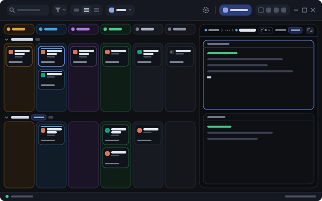

# Kanban

A Herdr app layout where every agent is a card in a column by status:
**Needs you**, **Working**, **Waiting**, **Done**, **Idle**, and every tab with no agent
(a shell, a server, an editor) is a card in **Terminals**. You can hide any column and
change the order of the columns. **Waiting** holds the Claude Code agents that look
finished but still wait for background subagents or background shell commands (see below);
you can turn it off.

A card moves between columns by itself when the agent changes status. Click a
card and the tab of that agent (all its splits) opens in the panel at the right,
as in Herdr's own layout.

## Quick Start

Copy and paste this prompt to your LLM agent:

`Read ~/.config/herdr-app/AGENTS.md, then add this layout: https://github.com/dougcunha/herdr-mods/tree/main/kanban-app`

Switch to the layout with `ctrl-shift-l`. Your own layout stays as it was.

## What you see

| Part | What it shows |
| ---- | ------------- |
| Top bar | Starts with **Filter** (search box and a filter button with a menu: all, the current space, one space, one machine), **Lanes** (3 icon buttons: none, by machine, by space) and the **Agent** button (the tab panel; its arrow picks where it shows); a **Settings** button (the gear icon, opens the gear menu: column width, stack columns, card view, bar icons or names, where panels open, Waiting column, the column chips, Herdr settings, Bar buttons, PowerMods) and **New agent** (opens the New session dialog); then **Panels** (Files, Changes and your dock buttons) and the window buttons. No title and no agent count: the status bar at the bottom shows the count. Drag the window by an empty spot of the bar (left of the gear button). |
| Columns | Needs you, Working, Waiting, Done, Idle, Terminals, in that order by default. Each has a color, a count, 2 arrow buttons that move it and an eye button that hides it. |
| Lanes | Off by default. By machine or by space: the column heads once on top, then one lane per machine or space, each a row of the same columns with its cards. A lane head has a chevron that folds the lane, the name, the machine chip of another machine and the card count. |
| Cards | The program icon, the space name in large bold text with the program name under it, the title, the Git branch, the folder (not when it is the space name), the age, a rename button (a pencil, when [Tab Namer](../tab-namer-app) is installed), a duplicate button and a pin. The title is the tab name when a person named the tab (not a number, not the program name), else the terminal title of the agent; the tooltip of a tab name shows the agent's title. A summary view shows 2 lines only. A right-click on a card (full or summary) opens its menu. |
| Terminal cards | One per tab with no agent, in the **Terminals** column: a terminal icon, the tab name ("Tab 2" for a tab nobody named) in large bold text with the space name under it, the machine chip of another machine, the folder of its terminal (not when it is the space name) and the pane count when the tab has more than one. The summary view has the tab name and the machine chip, then the space, the folder and the pane count. No status mark, age, pin or duplicate. A tab whose panes are all mod panes (a Files or Insights tab) has no card. |
| Tab panel | A head with the tab name, its space and its machine, and a maximize button; under it the active tab with all its panes (`{ "tab": "active" }`), each pane a card with Herdr's pane header. It sits right of the board (the default), left of it, or under it; the Files and Changes panel stays at the right. Drag its edge to resize. |

## How it behaves

- **Hide a column:** click its chip in the gear menu, or the eye button in the column header. A hidden chip is dim with a struck name. The choice is saved. If you hide all of them, the board says so, with a button that shows them all again.
- **Bring a hidden column back:** a hidden column stays in the row of column heads, at its place: a narrow dashed box with its icon and card count (tooltip "Show <name>"). Click it to show the column. With lanes, the lanes keep an empty spot under it, so the columns stay under their heads. With all columns hidden, the row of these boxes stays above the message.
- **Columns menu:** right-click a column head, a hidden column or an empty spot of the board (not a card: a card has its own menu) for a menu of all the columns: a tick shows the column, a click shows or hides it, and the menu stays open.
- **Column order:** click the `<` or `>` arrow in a column header. The column changes place with the next visible column at that side. Hidden columns keep their place in the row. At the edge of the board the arrow is dim. The chips in the gear menu follow the same order. The order is saved in `shared("kanban.order")`.
- **Column width:** the − and + buttons of the gear menu set the widest a column may be: 150, 180, 220, 260, 320, 400 px or **Auto** (the columns share the whole board). **Auto** is the step after 400 px. To go back to **Auto** in 1 click, click the value between − and +. The columns get narrower with the board, down to 150 px (120 px while the columns are stacked). Below that the board scrolls sideways and each column keeps that width. On a super wide monitor, pick 220 or 260 px to get narrow cards. The choice is saved in `shared("kanban.width")`.
- **Stack columns (small monitors):** the **Stack columns** row of the gear menu picks **Auto**, **On** or **Off**; the tooltip of **Auto** tells whether the board stacks now. The choice is saved in `shared("kanban.pairs")`; the command `kanban.pairs` (bind it in `keys.json`) steps Auto → On → Off → Auto. **Auto** (the default) stacks when the board has less than 220 px for each visible column (plus the gaps and 36 px for each hidden column). While the columns are stacked:
  - **Waiting** goes under **Working** and **Idle** under **Done**: each pair shares one place on the board, one column under the other, at the place of the first of the two in the column order. So the board has 3 places instead of 5, and each column is wider. With the Waiting column off, only Done and Idle share a place (3 places instead of 4).
  - The headers, cards and gaps are smaller. The arrows and the eye of a column header show only while the pointer is on the header, so the name has room.
  - With **Cards** on **Auto**, the cards are summary cards.
- **Bar (icons or names):** the **Bar** row of the gear menu picks **Auto**, **Icons** or **Names** for the top bar; it does not change the board. The tooltip of **Auto** tells what the bar shows now. **Icons** shows **New agent**, the filter, the Agent button and the panel buttons as icons with tooltips, the search box is 150 px. **Names** shows their names. **Auto** (the default) shows icons when the bar is narrower than 1800 px, names from 1800 px, and the names of the Agent and panel buttons only from 2250 px. The choice is saved in `shared("kanban.density")`, and the [Dock](../dock-app) bar uses the same value.
  - With either choice, the search, the lane buttons and the Agent button are in one row that scrolls sideways when the bar is too narrow. **Settings**, **New agent**, the Panels group and the window buttons always show.
  - Older versions had one **Density** row for both. The first start after the update takes **Compact** over as **Stack columns: On** and **Normal** as **Off**; the bar keeps its choice.
- **Panels in a dialog (small monitors):** the **Panels open in** row of the gear menu sets where the panel buttons open their panel: **Auto**, **Side panel** or **Dialog**; the tooltip of **Auto** says which one it is now. **Dialog** opens the panel in the middle of the window, 82% wide and 85% high, over the board. **Auto** (the default) opens a dialog when the window is narrower than 1600 px, else the side panel. These px are the px of the app: with a Windows scale of 125%, a 1920 px monitor has 1536 px. This applies to Files, Changes, the side panels of `dock/panels.json` and its tab entries (Insights): in **Side panel** mode a tab entry opens in its tab, as before.
  - The dialog has a title row with the name of the panel, a button that moves the panel to the side panel (to its tab, for a tab entry) and a close button. Esc and a click beside the dialog close it too. The button of the panel is lit while its dialog is open; a 2nd click on it closes the dialog, and a click on another panel button shows that panel in the dialog.
  - The panel in the dialog is a new copy of the mod: its scroll and selection start fresh.
  - The choice is saved in `shared("kanban.panelOpen")`, and the [Dock](../dock-app) bar uses the same value. A dialog stays open when you switch layout, and the button of its panel stays lit in the other bar.
  - Keys: `kanban.panel-open` steps the mode, and `kanban.panel-<id>` opens or closes a panel as its button does (for example `kanban.panel-files`). Bind them in `keys.json`.
- **Card view:** the **Cards** row of the gear menu picks **Auto**, **Summary** or **Full**. The choice is saved in `shared("kanban.cards")`. **Auto** (the default) shows summary cards while the columns are stacked. A summary card has 2 lines: the program icon, the space name, a pin mark when pinned and the status mark; then the terminal title (or the program and the branch). It has no age, so the title has more room. While the pointer is on the card, its buttons (duplicate, pin) show at the end of the title line. A click opens its tab, as on a full card.
- **Waiting column (agents that wait for subagents or commands):** the Herdr app shows a Claude Code agent as **Done** (or **Idle**) when it ended its turn after it launched background subagents or background shell commands (the Bash tool with `run_in_background`), even if they still run. The Kanban reads the transcript of that Claude session and, when subagents or commands are still running, shows the card in **Waiting** with a pulsing hourglass and a line such as "2 subagents", "1 subagent · 1 command" or "1 command · Run the tests" (with the description when there is only one). When the last one reports, the agent wakes up, works, and the card goes to **Done** by itself. A command that Claude stops with TaskStop also ends the wait.
  - **Turn it off:** click **Waiting column** in the gear menu (a tick while on). The choice is saved in `shared("kanban.waiting")`. Off, the column and its chip go away, the mod reads no transcript, and every agent shows as its Herdr status says, as before. To start with it off, add `"waiting": false` to the `props` of both `kanban` blocks in the layout (the gear menu wins after the first click).
  - **When it is unsure, the card stays where Herdr puts it.** The mod needs to know which Claude session runs in the terminal: it uses the process id of the terminal (exact when the terminal runs Claude directly; a terminal that starts Claude from a shell has the shell's id), then the `resume.session` label of the [agent-resume](../agent-resume-app) mod, then the folder when only one session started there after the terminal. Only Claude Code agents on this computer are checked.
  - **A card stuck in Waiting:** Claude Code does not always send the final notice of a subagent, and a server that Claude starts in the background and leaves on never ends. Seen once: a subagent that replied "done" while a Monitor it had armed was still alive stayed "waiting" for good. Two ways out. A card whose subagents and commands have not reported for **1 hour** goes back to Done or Idle by itself (change it with `"waitingMinutes": 30` in the `props` of both `kanban` blocks). The limit does not apply to a background command while Claude Code says that one runs (`"status": "shell"` in its session registry): a mutation test or a long build can run for hours. And a waiting card has a **check button** ("Not waiting"; on a summary card it shows while the pointer is on the card) that sends it back at once, until the agent takes another turn.
  - **Cost:** it reads a transcript only for a Claude agent that shows as Done or Idle, once per turn of that agent (and every 30 seconds for an agent known to wait). A typical transcript (1 to 5 MiB) takes some milliseconds; the biggest ones (30 MiB or more) a fraction of a second, off the screen thread.
  - **Auto stacking:** **Stack columns: Auto** stacks (and shows summary cards) below 220 px per visible column: about 1380 px with all 6 columns, about 1200 px with Waiting or Terminals hidden, about 1010 px with both hidden (a hidden column still takes 36 px; with the Waiting column turned off in the gear menu it takes none: about 1150 px). Hide a column, or set **Stack columns**, to change the limit. Terminals never shares a place with another column.
  - **Config folders:** the mod looks in every `~/.claude*` folder that has `sessions` or `projects` (some people keep `~/.claude` and `~/.claude-work` apart). If yours has another name, add `"claudeDirs": ["C:/Users/me/claude-home"]` to the `props` of both `kanban` blocks.
- **Working** cards have a pulsing line on top and a spinner. **Needs you** has a pulsing bell and an amber border. **Done** has a check. **Idle** has a moon.
- **Click a card:** its space and tab become the active ones (`space.select`, `tab.select`), so the tab panel shows that tab, and its pane gets the keyboard (`pane.focus`). `agent.focus` selects the agent for Herdr's `agent.next` / `agent.prev`. The panel opens when it was hidden. A terminal card does the same without `agent.focus`; the keyboard goes to the terminal pane its card shows (the focused one of the tab, else the first). Every card whose agent runs in the shown tab is lit (a terminal card too, when its tab shows), so 2 agents in one tab light 2 cards and both open the same tab. The space and the tab of the window change too, as when you pick them in the sidebar. A **Done** agent becomes **Idle** after you look at it, so its card moves.
- **Tab panel head:** the tab name (a tab nobody named shows "Tab 2"), the space and the machine (a chip for another machine, "This computer" here). With no tab, it says "No tab open: click a card".
- **Panel place:** click the **Agent** button to show or hide the tab panel; its arrow opens a menu: **Off**, **Right**, **Left**, **Bottom** (a tick on the one now). **Off** hides the panel and keeps its place; a place shows it there. At the bottom the board and the panel share one column, the board on top, and the Files and Changes panel keeps the full height at the right. The panel keeps its own width at a side and its own height at the bottom (460 and 360 px at first; drag the edge to change them). The place is saved in `shared("kanban.panelPlace")` (`right`, `left` or `bottom`; absent: right), the sizes in `shared("kanban.panelSize")`. The command `kanban.place` steps Right → Bottom → Left → Right and shows the panel. Bind a key in `keys.json`, for example `"layout:kanban": { "ctrl-shift-j": "kanban.place" }` (pick a key that is free in your `keys.json`).
- **Maximize:** the button at the right of the head (or **Open maximized** in the card menu, or the key `kanban.maximize`) hides the board, so the tab panel takes the whole room under the bar, in each place. Again: the board comes back, with the panel as big as before (`shared("kanban.maximized")` keeps that size). A new place while maximized stays maximized; back, the panel gets the size of the new place. The Files and Changes panel stays as it is. Bind a key in `keys.json`, for example `"layout:kanban": { "ctrl-shift-m": "kanban.maximize" }` (pick a key that is free in your `keys.json`).
- **Right-click a card** for its menu: **Rename the tab…** (a field with the tab name; Enter saves, Esc cancels, an empty name gives the tab its number again; works without Tab Namer), **Close the tab** (it says when the tab has more agents or panes, as in "Close the tab (2 agents)"; Herdr asks first when it is the last tab of its space), **New session here… ▸** (the New session dialog below, with the space and the machine of the card filled in), **Duplicate this agent ▸** (the duplicate menu below), **Open maximized** (its tab on the whole width, see Maximize) and **Pin** / **Unpin**. A terminal card has the same menu without **Duplicate** and **Pin**; it closes when an agent starts in that tab. A command that fails (a machine that is unavailable) shows an error notice.
- **New session** (the **New agent** button of the top bar, or **New session here…** in the card menu) opens a dialog, 440 x 520 px, with 4 things to pick:
  - **Machine:** this computer, or another machine of `hc machine ls`. One machine only: its name instead of a switch. The space and the program belong to a machine, so picking another one starts both over. An unreachable machine says so and **Start** is off (Herdr cannot start anything there).
  - **Space:** an existing space of that machine (its name and its Git branch), or **New space…** with an optional name.
  - **What to start:** **Terminal** (the default shell of the machine) or one of the agents installed there (the list of known agents; it says while it looks and when it finds none).
  - **Tab name:** optional. It takes the keyboard when the dialog opens, and Enter starts the session. Esc and **Cancel** close it.
  - An existing space gets a new tab (`tab.new`); **New space…** makes the space with that first tab (`space.new`). A command that fails shows an error notice.
- **Pin** keeps a card at the top of its column.
- **Lanes (swimlanes):** the 3 icon buttons after the filter pick how the board splits: **none** (three columns: one board, each column scrolls on its own, as before), **by machine** (a monitor with two lanes) or **by space** (a folder with two lanes). The choice is saved in `shared("kanban.group")`; the command `kanban.group` (bind it in `keys.json`) steps none → machine → space → none.
  - The column heads (count, arrows, eye) show once on top. Under them the lanes scroll as one list; a lane is as tall as its tallest column, so the columns of a lane do not scroll on their own. The columns of a lane have the order, the width and the stacked pairs (Waiting under Working, Idle under Done) of the heads.
  - **By machine:** "This computer" first, then the other machines in the order of Herdr's spaces, machines with no space last, by name (a lane head shows the machine chip). **By space:** the order of Herdr's spaces (this computer first, then the machines by name), with the machine chip for a space on another machine. An agent whose space is not known goes to a last lane **Other**. A terminal card goes to the lane of its space, or of the machine of its space (the lane of the agents there).
  - A lane with no card to show (search, filter, hidden columns) goes away. A space filter with lanes by space shows one lane.
  - **Fold a lane:** click its head. A folded lane shows only its head, with a colored dot and a count for each status it holds. The folded lanes are saved in `shared("kanban.collapsed")` (ids `machine:<name>`, `machine:` for this computer, `space:<id>`, `other`), so they stay folded after a restart. The id of a space that is gone stays in the list (a machine that is offline lists no space; its lanes keep their state).
  - Bind a key in `keys.json`, for example `"layout:kanban": { "ctrl-shift-g": "kanban.group" }` (pick a key that is free in your `keys.json`).
- **Filter:** the button next to the search (a funnel and what the board shows; only the funnel while the bar shows icons, the tooltip says it) opens a menu with a tick on the filter in use:
  - **All**: every agent.
  - **Current space**: only the cards of the active space; it follows when another space becomes active (in the spaces sidebar or with a key).
  - **Spaces**: one row per space (with the machine for a space of another computer); the board keeps that space, whatever space is active.
  - **Machines** (only with more than one machine): **This computer** or another machine; the board keeps its cards.
  - The filter keeps terminal cards by their space and its machine, as it keeps agents. The search box finds a terminal card by its tab name, space, folder or program.
  - The button is lit while a filter limits the cards. When the space or machine of the filter is gone, the board shows all and so does the button. With a filter and no card in a column, the column says "No match".
  - The choice is saved in `shared("kanban.filter")`. The command `kanban.filter` steps All → Current space → All (from a space or machine it goes to All). Bind a key in `keys.json`, for example `"layout:kanban": { "ctrl-shift-f": "kanban.filter" }` (pick a key that is free in your `keys.json`).
  - Older versions kept a funnel in `shared("kanban.scope")` and `shared("kanban.scopeSpace")`: the first start takes them over (a kept space becomes that space, a funnel without a space becomes Current space) and clears them.
- **Duplicate** (the copy button of a card) opens a menu with 2 items. Each item starts a new session of the same agent with the same flags, without the flags that continue a session (`--resume`, `--continue` and the like):
  - **Duplicate in this space** opens it in a new tab of the same space, in the folder of the agent.
  - **Duplicate in a new worktree…** opens Herdr's worktree dialog. Type a branch: Herdr makes the worktree and opens a new space with the agent in its first tab.
  - The mod reads the command and the flags from the `resume.agent` and `resume.args` labels of the [agent-resume](../agent-resume-app) mod. Without these labels, it starts the command of the program from the list of known agents, with no flags.
- **Files and Changes:** the two buttons in the top bar open Herdr's own Files mod and the [Git](../git-client-app) mod (changes, hunks, commit and the commit graph) in a side panel at the right (368 px, drag its edge to resize). Click the same button again to close the panel; click the other one to switch. It starts closed.
- **Your dock buttons:** the group of buttons also lists every entry of `~/.config/herdr-app/dock/panels.json`, the file the [Dock](../dock-app) layout reads (CI, Pending, PRs, Insights, ...). An entry with `"opens": "panel"` (the default) becomes a block of the same side panel; the Kanban top bar adds it to the layout by itself the first time. `"opens": "tab"` opens a tab with the mod; it shows in the tab panel. `"opens": "command"` runs a Herdr command (`layout.switch` entries are not shown). A save of the file shows in the bar at once. If you remove an entry, its block goes too.
- **Git button:** the Changes button and the entries with `"group": "git"` in `panels.json` (Pending, PRs) share one **Git** button with a small arrow. Click it to open a menu with the full name of each panel and a tick on the open one. Click a row to open or close that panel. The Git button is lit while one of its panels is open. The [Dock](../dock-app) bar has the same button. `kanban.group-git` opens the menu from a key.
- **Other layouts:** the bar has no layout switch. Use `ctrl-shift-l` (`layout.switch`).
- **Next and previous card:** the commands `kanban.next` and `kanban.prev` select the next or the previous card as a click does, in the order of the cards on the board, terminal cards too (with lanes: lane by lane, column by column; hidden columns, the cards of a folded lane and the cards the filter or the search leave out are skipped). They start from the selected card (with 2 agents in the shown tab: the one whose pane has the keyboard, else the first) and go round at the end; with no card selected they take the first or the last one. They work while the panel is maximized too.
  - Herdr's own `agent.next` and `agent.prev` follow the same order without the terminal cards (they walk agents only), but the tab panel does not follow them: the panel changes only on a click, `kanban.next` or `kanban.prev`. A focus on a shell split, the Files or Changes panel or any other block does not move the panel either.
  - Bind the keys you use for `agent.next` / `agent.prev` (see the `global` section of your `keys.json`, or `keys()`) to the kanban commands in the `layout:kanban` section, which wins over `global` while this layout shows; a key that the `terminal` section of `keys.json` binds too keeps that binding while a terminal has the keyboard (`terminal` wins over both). For example `"layout:kanban": { "ctrl-shift-down": "kanban.next", "ctrl-shift-up": "kanban.prev" }` (pick keys that are free in your `keys.json`, or the ones `agent.next` and `agent.prev` have).
- Window buttons, drag area and resize work as in the Dock layout (`titlebar: none`).

## What it adds

| Part | What it is |
| ---- | ---------- |
| `layouts/kanban.json` | The window: spaces sidebar (hidden at start), top bar, board plus tab panel and status bar. |
| `layouts/kanban.svg` | The picture for the settings screen. |
| `mods/kanban/` | One mod with three parts, chosen by `props.part`: `bar`, `board` and `tab-head` (the head of the tab panel). They share state through `shared()`. `waiting.js` finds the agents that wait for subagents, `terminals.js` makes the cards of the tabs with no agent, `lanes.js` sorts the cards into lanes, `filter.js` holds the filter, `density.js` the rules of the Bar and Stack columns settings, `place.js` moves the tab panel to its place. |

Language: the mod shows English. Add `"lang": "pt"` to the `props` of all three
`kanban` blocks in the layout for Portuguese. With the `mods-hub` mod, the
**Language** setting of its **Kit** section (`shared("herdr-mods.lang")`) wins
over the prop, in every bar of the kit, and changes the bar at once. The text
in the search box changes after a restart.

The gear button of the bar opens a menu. At the top, the look of the board and the bar:
**Column width** (− / value / +), **Stack columns**, **Cards**, **Bar**, **Panels open in** and **Waiting column**;
then **Columns**, one chip per column with its card count (a click shows or
hides the column; the arrows in a column header change the order). These rows
change the board at once and the menu stays open. At the bottom: **Herdr
settings**, **Bar buttons** and, with the `mods-hub` mod installed,
**PowerMods** (the dialog on its **Settings** tab). `kanban.gear` in
`keys.json` does the same.

**Bar buttons** opens a list of the buttons of the Panels group (Files, the Git
group, your dock buttons and commands). The top of the list is the left of the
bar. Each row has ↑ and ↓ to move the button, and an eye to show or hide it.
**Reset** goes back to the order of `dock/panels.json` with all buttons shown.
A hidden button still opens its panel with its key in `keys.json`, and the
panels of a hidden group button stay in its menu (`kanban.group-<id>`). The
choice is saved in `shared("kanban.barButtons")`, and the [Dock](../dock-app)
bar reads the same value, so both bars show the same order. A new entry of
`panels.json` comes at the end. `kanban.buttons` in `keys.json` opens the list.

## What it does on your machine

- It reads the live data of Herdr (agents, spaces, panes). It stores 18 values in `shared()`: `kanban.hidden`, `kanban.query`, `kanban.filter`, `kanban.group`, `kanban.collapsed`, `kanban.maximized`, `kanban.panelPlace`, `kanban.panelSize`, `kanban.width`, `kanban.order`, `kanban.density`, `kanban.pairs`, `kanban.cards`, `kanban.panelOpen`, `kanban.panelDialog`, `kanban.barButtons`, `kanban.waiting` and `kanban.waiting.dismissed`.
- It reads `dock/panels.json` and the folder list of `mods/` in the Herdr home, and watches the `dock/` folder.
- It edits `layouts/kanban.json` with the `layout.set` command, to add or remove the side-panel blocks of `panels.json`, and once to update the layout of an older version: it removes the shell block (`shell` in `board-main`) and the Terminals view (the stack `view` with `tabs-view`), and turns the agent block `detail` into the tab panel.
- With the Waiting column on, it reads (never writes) files in your Claude Code folders under your home folder: `sessions/*.json` (with the `status` field: `"shell"` while a background command runs) and the transcript `projects/*/<session>.jsonl` of the Claude agents that show as Done or Idle. It runs `hc get <terminal> --json` for them. It reads a transcript again only when the agent changes turn, and every 30 seconds for an agent known to wait. Nothing leaves your computer.
- At start it runs `hc get kanban-shell --json`; when that terminal of an older version (label `kanban.shell=1`) has ended, `hc rm` removes it; while it still runs, it stays and the log says to end it with `hc kill kanban-shell`.
- When you duplicate an agent, it runs `hc get <terminal> --json` to read its labels, and opens Herdr's `worktree` dialog for a new worktree.
- Besides the reads above, it runs Herdr commands only: `agent.focus`, `terminal.pin`, `tab.select`, `tab.rename`, `tab.close`, `space.select`, `pane.focus`, `pane.zoom`, `layout.select`, `layout.show`, `layout.hide`, `layout.toggle`, `layout.resize`, `layout.set`, `tab.new`, `space.new`, `window.*`, `app.settings`, `mod.open`, and the `run` of a command entry of `panels.json`.
- It runs no program other than `hc`, except for a remote agent: there the Waiting column reads the transcript with `sh` (or PowerShell) on that machine through Herdr. It uses no network of its own.

## Limits

- It uses the shipped mods `workspace-chrome`, `spaces`, `workspace-status` and `pane`.
  They come with Herdr and are not copied here.
- The Changes panel is the `git-client` mod ([this repository](../git-client-app)). Install it before the layout, or the panel stays empty. To go back to Herdr's own Changes panel, point the `changes` block of `layouts/kanban.json` to the mod `changes`.
- The age on a card is the age of its **tab** (`changed_at` or `working_since`). A tab with 2 agents shows the same age on both.
- The Waiting column depends on how Claude Code writes its transcript (tested with Claude Code 2.1.318): a tool result "Async agent launched … agentId" and `<task-notification>` records. If a new version changes that, the column stays empty and the agents show as Done or Idle, as before. Background shell commands are counted too: a tool result "Command running in background with ID", or the status `"shell"` in `sessions/<pid>.json`. Other agents (Codex, …) are not checked.
- Built and tested on Windows with Herdr 0.1.12. Untested: macOS, Linux, remote machines.
- `RECIPE.md` has the full brief to build it from scratch.
