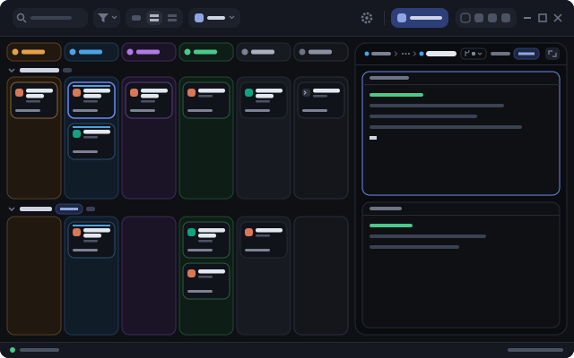

# Kanban

A Herdr app layout where each agent is a card in a status column: Needs you, Working, Waiting, Done, Idle. The person can hide any column and change the order of the columns. A panel at the right shows the tab of the clicked agent with all its splits, as in Herdr's own layout, under a head with the tab, its space and its machine; it can take the whole width.

## What you see

Left to right, top to bottom (zoom 1):

- **Sidebar**, hidden at start (`"hidden": true`; `ctrl-shift-b` shows it), 240 px, `chrome` background: the shipped `workspace-chrome` brand (46 px), the shipped `spaces` list, the `workspace-chrome` footer (69 px). The board does not need it. While it is hidden on macOS, the bar gets 76 px of left padding so the window buttons do not cover the search box.
- **Top bar**, 44 px, `chrome` background, 1 px bottom border, `window_drag`, 10 px right padding. No title and no agent count (the `workspace-status` footer shows the count). From the left, directly after the left padding (14 px, 10 px compact, 76 px on macOS with the sidebar hidden), with a 1 px line (`divider`) before "New agent":
  1. **Filter**: a search box 220 px wide (150 px compact) and the filter button: a `panelButton` in a `buttonGroup` with the `filter` icon, what the board shows ("All", "Current space", the space name or the machine name, cut at 24 characters; only the icon in compact) and a `chevron-down`, lit while a filter limits the cards; its tooltip says what it shows. A click opens the filter menu (`openFilter`); then **Lanes**, a `segmented` with 3 icon-only items (`lanes-none` three columns "One board, no lanes", `lanes-machine` a monitor with two lanes "A lane per machine", `lanes-space` a folder with two lanes "A lane per space"; the tooltips name them) that writes `shared("kanban.group")`; then one rounded group with the "Agent" split button: a `panelButton` with the icon of the place (`panel`, `panel-left`, `panel-bottom`), lit while the tab panel shows, and a `menuArrow` (a 10 px `chevron-down`, tooltip "Where the tab panel shows") that opens the place menu (`openPlace`: a popup of the `kanban` mod with `part: "place-menu"`, 200 px wide, `MENU_PAD` and 4 rows of `MENU_ROW`): Off (`eye-off`), Right, Left, Bottom, a `tick` on the one now; a click runs `setPlace` and closes the menu. These sit in `kb-strip` (`flex_1`, scrolls sideways when too narrow); after it a plain 16 px spot that stops no press, so the window drags by it even while the strip is full (the empty end of the strip, the padding and the gaps drag too).
  2. A 28 px icon button with the `settings` icon (tooltip "Open the settings"); it is outside `kb-strip`, so it always shows. A click (or the command `kanban.gear`) reads `<appHome>/mods/mods-hub/mod.json` and opens the **gear menu** (`openGear`): a popup of the `kanban` mod with `part: "gear-menu"`, `GEAR_W` (340 px) wide and as tall as its rows (`MENU_PAD`, 2 heads of `MENU_HEAD`, 5 rows of `GEAR_ROW`, the Waiting row, one `MENU_ROW` per column of `COLUMNS` (room for Waiting even while it is off), `GEAR_HINT`, `GEAR_SEP`, 2 or 3 link rows). Its props: `lang`, `hub`, `waiting` (the bar's `props.waiting`), `bar` (what the bar shows now: `icons`, `mixed` or `names`, from `barLook`), `narrow` (the bar is narrower than `PANEL_NARROW`, so Auto opens a dialog) and `counts` (the card count of each column when it opened). The rows, under the head "Settings": "Column width" (`width` icon; `−`, the value, `+`; while a width is set, the value is a button that sets Auto, `shared("kanban.width")` = null), "Stack columns" (`stack` icon; a `segmented` Auto / On / Off in `shared("kanban.pairs")`, the tooltip of Auto says "stacked now" or "side by side now" from `globalThis.__kanbanBoard.stacks`, which the board sets on every render (`undefined` before its first layout and while it shows an empty state: then only the rule); the tooltip of On says what it stacks), "Cards" (`cards` icon; Auto / Summary / Full), "Bar" (`density` icon; Auto / Icons / Names in `shared("kanban.density")`, the tooltip of Auto says "icons now", "names now, the panel buttons as icons" or "names now"), "Panels open in" (`dialog` icon; Auto / Side panel / Dialog in `shared("kanban.panelOpen")`, the tooltip of Auto says "dialog now" or "side panel now"), "Waiting column" (`hourglass` icon, a `tick` while on); under the head "Columns": one `columnChip` per column in the column order (`columnToggles`, shared with the columns menu), then the hint "The arrows in a column header change the order."; a 1 px line; then "Herdr settings" (`settings` icon, runs `app.settings`), "Bar buttons" (`buttons` icon, runs `kanban.buttons`) and, when the mods-hub is there, "PowerMods" (`mods` icon, a copy of `hub.svg` of the mods-hub; it writes `tab: "settings"` and `section: "kanban"` into `shared("mods-hub")`, keeping its other fields, then runs `mod.open {name: "mods-hub"}`). The settings write their keys and the menu stays open; a link row closes it. Then a primary "New agent" button (`bot` icon) that opens the New session dialog (`openNew`).
  3. **Right end**, 6 px between its parts: the **Panels** group ("Files", "Changes", the entries of `dock/panels.json` that open a panel or a tab, lit while their panel shows, then the command entries that are not `layout.switch`; the buttons with the same `group` become one group button, so Changes, Pending and PRs show as one **Git** button); the window buttons (28 px, 2 px apart) when `window().buttons`. The panel buttons show their names in `normal` density, only icons with tooltips in `compact` density, and in `auto` their names only when the bar is 2250 px wide or more.
- **Board**, `canvas` background, 12 px padding and gap. 5 columns of equal width (min 150 px; max set by the width control: 150, 180, 220, 260, 320, 400 px or Auto = no max, `shared("kanban.width")`; the board block has `min: 160` in the layout; the board scrolls sideways only when the columns do not fit at their minimum width, and then each column has exactly that width), in this default order: Needs you, Working, Waiting, Done, Idle. A column is a 16 px rounded box with a 1 px border and a background tinted 5% with its status color (`theme().idle`, `blocked`, `working`, `done`; Waiting has no theme color: `ansi5`, else `accent`). Header 48 px: a 26 px tile with an icon (moon, bell, zap, hourglass, check), the name (13 px semibold), a count badge, a chevron-left and a chevron-right button, an eye-off button.
- **Lanes** (`shared("kanban.group")` is `machine` or `space`): a `column` (`kb-board`) with the row of column heads (each a column box with only its header and the count of all visible cards of that status; `items_start`, so a single head does not stretch to the height of a stacked pair), then a `column` `kb-lanes` (`flex_1`, `overflow_y_scrollbar`, gap 12 px, 8 px compact) with one lane each. A lane: a 30 px head (8 px radius, `foreground` tinted 4%, hover `hover`; a 14 px `chevron-down`, `chevron-right` while folded; the name 13 px semibold: "This computer", the space name, or "Other"; a `machineChip` for another machine (by machine it is the name); a count badge; folded: a 7 px dot in the status color and the count for each status it holds), then, unless folded, a row of the same places as the heads (the same `sized()` widths, the stacked pairs one under the other). Each place is a column box (the same `frame`) with the cards, 10 px (7 px compact) padding, no scroll and no empty-column box. The rows are plain `flex` rows (not `h_flex`, which centers), so every box stretches to the tallest column of its lane; in a pair the second box takes what is left. When the board scrolls sideways, the head row and `kb-lanes` get the width of the places plus the gaps. No lane to show: "No agents here" ("No match" while searching) in `dim`.
- **Card**, `background` color, 12 px radius, 1 px border, 12 px padding, 9 px gap: a program tile (28 px, from `program.tile` and `program.icon`), the program name, the space name, a status mark at the right; the title (12 px, 2 lines max): the tab name in `foreground` when a person named the tab (`tab_name` is not a number and not the program name; the tooltip shows the agent's title), else the terminal title in `muted`; pills for the Git branch (mono) and the folder; a footer with the age and icon buttons (rename, when the `tab-namer` mod is installed; duplicate, pin). A card whose agent runs in the tab the panel shows has a `raised` background, an `accent` border and the `md` shadow; 2 agents in one tab light 2 cards.
- **Compact board** (Stack columns on, or Auto on a small monitor): column min 120 px, 8 px gap, 12 px radius, header 40 px (8 px padding, 4 px gap, 22 px tile, 12 px name, 20 px buttons), cards with 9 px padding and a 24 px program tile, an empty column box of 64 px. The columns of a group share one place, one under the other (a `column` with the same gap), at the place of the first of them in the order: Working with Waiting, Done with Idle. The header arrows and eye show only while the pointer is on the header (`on_hover`). The bar does not change with it.
- **Compact bar** (Bar: Icons, or Auto below 1800 px): "New agent", the filter, the Agent button and the panel buttons show their icons only with tooltips, the search box is 150 px, left padding 10 px and gap 6 px. In Auto from 1800 px the bar is normal, but the Agent and panel buttons keep their icons only until 2250 px.
- **Summary card**, `background` color, 9 px radius, 1 px border, padding 7 × 9 px, 4 px gap: line 1 is a 20 px program tile, the space name (12 px semibold), a pin icon when pinned and the status mark; line 2 (20 px high) is the title (the tab name or the terminal title, as on the card), else the program name and the branch (11 px `muted`), with no age so the title has room. While hovered, icon buttons of 20 px (rename when `tab-namer` is installed, duplicate, pin) show at the end of line 2.
- **Rename** (a Lucide pencil, `pencil.svg`): shown when `mods/tab-namer/mod.json` exists (checked at start and every 60 s). A click runs `openOverlay({ mod: "tab-namer", kind: "dialog", width: 460, props: { tab, terminal, lang } })`.
- **Side panel** (`panel`), at the right of the board and the tab panel, 368 px (min 240, max 1200), hidden at start: a stack `panel-body` with the shipped `files` mod and the `git-client` mod of [`git-client-app`](../git-client-app) (block id `changes`).
- **Tab panel** (`detail`), a `column` 460 px (min 200, max 4000, `resizable: false` inside), `background` color, 1 px `border`, 14 px radius, `md` shadow, at the right of the board in `work-body` (the shipped layout). Left: before the board. Bottom: a `column` `work-main` (gap of `work-body`, `min` of the board) in the place of the board holds the board over the panel, the side panel stays beside it:
  - **Head** (`detail-head`, 36 px, the `kanban` mod with `part: "tab-head"`), `chrome` background, 1 px bottom border, 14 px left padding: the tab name (13 px semibold; a tab nobody named, a number or `tb<n>`, shows "Tab <place>"), a `dim` "·", the space name (12 px `muted`), "·", the machine (`machineChip` for another machine, "This computer" in `dim` here), and at the right a 26 px icon button `maximize` (`minimize` and lit while maximized). With no active tab: "No tab open: click a card" in `dim`.
  - **Tab** (`detail-tab`, 8 px padding): `{ "tab": "active", "pane": { header: mod "pane" (30 px, top, always), background, 1 px border, accent focus, radius 10, gap 8, lone: true } }`. Herdr has no block for a given tab, only the active one, so a card click makes the agent's space and tab active.
- **Status bar**, 28 px, the shipped `workspace-status`.

## How it behaves

- Status to column: `idle` to Idle, `blocked` to Needs you, `working` to Working, `done` to Done. Inside a column: pinned first, then the highest `seq` first.
- **Waiting** is not a Herdr status. A Claude Code agent (`app: "claude-code"`) that shows as `done` or `idle` while background subagents or background shell commands still run is shown as `waiting` (the card gets `status: "waiting"` and `wait: { count, items }`). `mods/kanban/waiting.js` finds them; it imports only `fs/promises`, so a Node script can test it:
  - The session of a terminal, in this order: the process id (`pid`, `foreground.pid` or label `resume.pid` of `hc get <t> --json`; for a Claude started from a shell these are the shell's, so they do not match) against `<config>/sessions/<pid>.json` (`{ pid, sessionId, cwd, startedAt }`); the label `resume.session`; the folder, only when exactly one session started there after `created_ms`. Unsure: no session, and the card stays where Herdr puts it. The config folders are every `~/.claude*` with `sessions` or `projects`, or `props.claudeDirs`.
  - The transcript is `<config>/projects/<cwd with every non-alphanumeric character as "-">/<sessionId>.jsonl` (the folder is found by listing if that guess misses).
  - Only structural records count: the launch is the tool result of an `Agent` or `Task` tool call (a shell command can print the same words), and a notification is a `queue-operation` record, a user message that starts with it, or a `queued_command` attachment. One record can hold several `<task-notification>` blocks: each is read on its own.
  - A subagent is pending when the transcript has a tool result "Async agent launched … agentId: <id>" for it and its last `<task-notification>` for that `<task-id>` is interim or absent. A notification is interim when it says the agent "is waiting on its own background work" (the subagent started a background job of its own and has not reported); any other one means it finished. Do not trust `subagents/agent-*.meta.json` `finished`: it turns `true` at the interim notification. A pending subagent that has not reported for 1 hour (`props.waitingMinutes`, counted from its last notification, else its launch) is ignored: Claude Code can leave a finished subagent marked interim for good (seen: the subagent ended while a Monitor it had armed was still alive, and no final notice came).
  - A background shell command is pending when the transcript has a tool result "Command running in background with ID: <id>" of a `Bash` tool call with `run_in_background: true`, and no `<task-notification>` for that `<task-id>` follows (a command has no interim notice: any notification ends it). A `TaskStop` call (`KillShell` or `KillBash` in older versions) with `task_id` (or `shell_id`) <id> also ends it, because a stopped job gets no notification. The item has `kind: "shell"` (a subagent has `kind: "agent"`) and the description of the Bash call. Also, when `<config>/sessions/<pid>.json` of the session has `"status": "shell"` (Claude ended its turn while a background command runs) and the transcript shows no pending command, the mod adds 1 shell item that counts from `statusUpdatedAt`. Another status changes nothing (just after the turn ends it can still say `busy`). While the registry says `shell`, every shell item gets `live: true` and the 1-hour limit does not apply to it (a mutation test can run for hours). Without that status, the limit applies to commands too. A server that Claude leaves on in the background keeps the status `shell`: its card stays in Waiting until the person clicks "Not waiting".
  - The card text: "N subagents", "N commands", both joined with " · ", and the description when there is only 1 job.
  - The card is waiting only for the turn it was read in (`terminals()[i].turn`): when the agent works again the answer is stale and the card goes back at once. A transcript is read again when a candidate changes `turn`, and every 30 seconds while some agent waits. Both parts (`bar` for the chip counts of the gear menu, `board`) run their own tracker.
  - The column and its chip exist only while `waitingOn()` is true: `shared("kanban.waiting")` (`"on"` or `"off"`, set by the Waiting row of the gear menu), else `props.waiting !== false`. Off, nothing is read and every agent keeps its Herdr status.
  - A waiting card has a `check` button ("Not waiting") that stores `shared("kanban.waiting.dismissed")[address] = turn`: the card shows as Done or Idle until that agent takes another turn.
  - A saved `shared("kanban.order")` without `waiting` gets the column right after the column that comes before it in the default order (under Working).
- **working**: a 2 px line on top of the card pulses (`loop opacity 0.2 to 1, 1400 ms`) and a spinner turns (`spin 900`). **blocked**: the bell pulses (`0.3 to 1, 1100 ms`), the border is amber, the column tile pulses. **done**: a check. **idle**: a moon.
- A column chip (gear menu) toggles the column. Hidden: dim, the name is struck, the dot is hollow. The list of hidden ids is `shared("kanban.hidden")`. With all of them hidden the board shows a message and a "Show all columns" button.
- While a column is hidden (but not all), a chip "＋ N hidden" (`moreCols`, 104 px wide, a 26 px pill with a dashed `border` line, 12 px `muted` text; its tooltip names the hidden columns) sits after the column heads, as tall as a head: without lanes at the end of the row of columns (in a `column` so it stays at the top), with lanes at the end of the head row, and each lane row gets 104 px plus a gap of right padding so the columns stay under their heads. The 104 px and a gap count in the width at which the board scrolls sideways and in the width below which Stack columns: Auto stacks. A click on it, or a right click on any column head (`on_mouse_down("right")` with `stop_propagation`), opens the **columns menu** (`openColumns`): a popup with `part: "columns-menu"`, 220 px wide, `MENU_PAD * 2 + MENU_HEAD + columns * MENU_ROW` tall, props `lang`, `waiting` (the board's `props.waiting`, so it lists the same columns) and `counts`. Head "Columns", then one row per column in the column order: an 8 px dot in its status color (hollow while hidden), the name (`dim` while hidden), the card count, a `tick` while it shows. A click toggles the column (`toggleColumn`, the same as the chips) and the menu stays open.
- The chevrons in a column header swap the column with the next visible column to the left or right. Hidden columns keep their place. At the edge the chevron is dim and does nothing. The order is `shared("kanban.order")`, a list of column ids; unknown ids are dropped and a missing column goes after the column that comes before it in the default order. The chips of the gear menu and `setAgentOrder` follow the same order.
- Lanes: `groupLanes` (`mods/kanban/lanes.js`, no Herdr calls) takes the visible agents of the shown columns and makes the lanes; a lane with no agent is not made. By machine (the `<machine>/` of the address): id `machine:<name>` (`machine:` for this computer), this computer first, then the machines in the order of their first space in `spaces()`, then the machines with no space by name (`localeCompare`). By space: id `space:<id>`, in the order of `spaces()`, then `other` for agents whose space is not in `spaces()`. A click on a lane head adds or removes its id in `shared("kanban.collapsed")` (a list of strings; ids of spaces that are gone stay, because an offline machine lists no spaces). The command `kanban.group` (`nextCommand`, in the bar) steps `none` → `machine` → `space` → `none`.
- The search box filters on title, program, space, tab and branch (`shared("kanban.query")`).
- Filter: `shared("kanban.filter")` is `{ kind, id? }`: `all`; `current` (the active space of `spaces()`, read on every render); `space` with a space id; `machine` with a machine name (`null` for this computer, as `machineOf` and the lanes). `mods/kanban/filter.js` (no Herdr calls): `parseFilter` (a bad value: none), `migrateFilter`, `resolveFilter` (a space that is not in `spaces()`, `current` with no active space, a machine that is not in `machines()` without `temporary`, or a machine filter with only one machine: all) and `applyFilter` (by `a.space`, or by the `<machine>/` of the address). `visible()` applies it before the search, so the columns, the counts, the lanes and `setAgentOrder` follow it. An empty column says "No match" while a search or a filter is on. Migration (`savedFilter`, once): with no valid `kanban.filter` and an old `shared("kanban.scope")` or `shared("kanban.scopeSpace")`, `scope` `space` with a space becomes `{ kind: "space", id }`, `space` without one `{ kind: "current" }`, anything else `all`; it writes `kanban.filter` and sets both old keys to null. No other mod reads the old keys.
- The filter menu: `openOverlay({ mod: "kanban", kind: "popup", width: 260, height, props: { part: "filter-menu", lang } })` at the pointer; `height` = 2 x 5 px padding + 26 px per section head + 32 px per row, at most 440 px (then it scrolls). Rows (`filterItems`, read live in the popup): "All" (`board` icon), "Current space" (`locate` icon, the active space name in `dim` at the right), the head "Spaces" and one row per space (`folder` icon, the name, a `machineChip` for another machine), and with more than one machine the head "Machines" and one row each ("This computer" first, `server` icon). The row of the filter in use has an `accent` tint and a `tick`. A click writes `kanban.filter` and closes the popup. The command `kanban.filter` steps `all` → `current` → `all` (`space` and `machine` go to `all`).
- Click a card (`select`): `agent.focus {terminal}`, `space.select {id: space}`, `tab.select {id: tab}`, `pane.focus {terminal}`, and `layout.show {id:"detail"}` when the panel is hidden; ids as `agents()` gives them (remote ones keep their `<machine>/` prefix); a command that throws or rejects shows an error notice. The pin button runs `terminal.pin {terminal, pinned}`.
- `kanban.next` / `kanban.prev` (bar `nextCommand`, `stepCard`): the bar computes the card order itself (`cardOrder`, the same as for `setAgentOrder`: place by place as the board draws them, stacked or not from `kanban.pairs` and, for Auto, `globalThis.__kanbanBoard.stacks`), so it holds while the board is hidden. `nextCard` (`mods/kanban/lanes.js`, no Herdr calls) takes the selected card (the card of the last step while its select has not landed yet; else in the shown tab the agent of `focused().terminal`, else of `focused().pane`, else the first card of that tab), steps one card and goes round at the end; with none it takes the first or the last card. Then `select`, as a click. The mod does not follow `focused().agent`: Herdr falls back to the first agent when the focus is on a pane or block without one, so following it jumped to another tab.
- Maximize (`toggleMaximize`; the head button, the card menu row "Open maximized" after its `select`, and the command `kanban.maximize`; copies other than the bar forward it with `run("kanban.maximize")`, so only the bar acts): stores the panel size (`layout().detail.size.px`, else the size of the place in `shared("kanban.panelSize")`) in `shared("kanban.maximized")` (Herdr keeps it in `shared.json` across restarts), runs `layout.hide {id:"board"}` and `layout.resize {id:"detail", weight: 1}` (and `layout.show {id:"detail"}` when hidden). Again: `layout.show {id:"board"}`, `layout.resize {id:"detail", px}` with the stored size (else the size of the place), and the key is cleared. Maximized = the `board` node is `hidden` in `layout()`. These are layout clicks, so Herdr keeps them after a restart. The Agent button on a maximized panel brings the board back first, then hides the panel. While a move of the panel waits to land (`placing`), the click waits too (a flag, `pendingMax`; the hide of the Agent button and of Off waits with it, so board and panel never hide both) and runs in the first bar render that sends no `layout.set` (`maxLater`); Off in the place menu of a maximized panel runs `kanban.place-off`, so the bar does both steps.
- Right-click a card (full or summary; `on_mouse_down("right")` with `stop_propagation`): `openCardMenu` opens `openOverlay({ mod: "kanban", kind: "popup", width: 250, height, props: { part: "card-menu", lang, address } })` at the pointer; `height` is 2 x 5 px padding + 26 px head + 32 px a row (`cardMenuItems`, which the popup builds again from the live agent). The head is the space and the tab name. Rows: "Rename the tab…" (`pencil`), "Close the tab" (`close`; "Close the tab (2 agents)" or "(3 panes)" when the tab has more; runs `tab.close {id}` with no `confirmed`, so Herdr asks before the last tab closes its space), "New session here…" (`plus`, a `chevron-right`; opens the `new-dialog` with the space and the machine of the card), "Duplicate this agent" (`copy`, a `chevron-right`; opens the `clone-menu`), "Open maximized" (`maximize`: the click on the card, then Maximize) and "Pin" / "Unpin" (`pin`). A row acts, then closes the menu; a command that throws or rejects shows an error notice. Tab ids go as `agents()` gives them (remote ones keep their `<machine>/` prefix). "Rename the tab…" opens the `card-rename` popup (300 px; 2 x 5 + 26 + 40 + 38 px): a `textField` filled with `tab_name` (empty when it is only a number; placeholder "Empty: its number again"), Cancel and Save. Enter (`submit`) and Save run `tab.rename {id, name}` (trimmed; "" gives the tab its number), Esc and Cancel close it.
- The New session dialog (`openNew(pre)`, from the "New agent" button of the bar, the button of the empty board and the card menu): `openOverlay({ mod: "kanban", kind: "dialog", width: 440, height: 520, props: { part: "new-dialog", lang, space?, machine? } })`. A dialog, not a popup: a form this tall does not fit beside the pointer, and Herdr's own `worktree` dialog is the same kind of form. `takeNew` keeps the machine (its name, null for this computer), the space (null: a new one), the agent key (null: a terminal) and 2 `InputState` fields; from the card menu the space and its machine are filled in, from the bar the space of the window (`focused().space`). The tab name takes the keyboard at once and again after 40 ms, and `submit` of either field starts. From the top, inside 5 px of padding: a 34 px head "New session"; a 36 px row "Machine" (a 90 px label and a `segmented` of `machines()` without the `temporary` ones, this computer first and called "This computer", the others with a `server` icon; with one machine only, a `machineChip` or that text instead of a switch); the head "Space" (26 px, as `MENU_HEAD`); the spaces of that machine (`flex_1`, scrolls, 30 px rows: a `folder` icon, the name, the branch at the right, a `tick` and an accent tint on the chosen one), else the hint "No space on this machine yet"; a 30 px row "New space…" (`plus`) and, while it is chosen, a 36 px field for the name of the space; the head "What to start"; the list (`flex_1`, scrolls) with "Terminal" first, then `knownAgents({ on })` kept to the `installed` ones that have a `run`, each with its program icon (`icon` with `tint` and `color`, else `bot`) — the hint "Looking for agents…" while the read runs, "No agent found on this machine" when it finds none or the check failed; a 36 px field "Tab name"; a 48 px foot with Cancel and a primary "Start" (`plus`). The 2 lists share the height that is left, so the dialog does not grow with the number of spaces or agents. Picking another machine clears the space and the agent and reads the agents again (the newest read wins, `knownTurn`). Start runs `tab.new {space, name?, argv?}` for an existing space, else `space.new {machine, name?, tab?, argv?}` (`machine: ""` is this computer; leaving it out would follow the focused space); once it succeeded, `layout.show {id:"detail"}` when the tab panel is hidden; then it closes — act first, then close, as a card menu row does. While the `layout` of the machine is `unavailable` (read live, so a machine that was still loading counts too), the foot says "`<name>` cannot be reached now" with its name, Start is `disabled` and Enter does nothing: structural commands fail there. Esc and Cancel close it.
- The bar reads `dock/panels.json` (`{ "panels": [ { id, label, icon, mod, props?, opens?, name?, run?, args?, group? } ] }`) and watches the `dock/` folder. An entry is skipped when its id is bad (`a-z`, `0-9`, `-`, up to 32), twice, has no label or icon, or its `mod` is not in `mods/` (a command entry needs `run` instead of `mod`). A broken file keeps the last good list and shows an error toast.
- Buttons of one rounded group, in this order: Files, Changes, then the file's entries as listed (`panel` and `tab`), then its `command` entries that are not `layout.switch` (those are not shown). `panel` entries (default) are added as blocks `{ id, type: "block", content: { mod, props? } }` to `panel-body` with `layout.set`, once per file version and layout, and only after the file has loaded; the ids added are kept in `localStorage` (`kanban.injected`) so an entry removed from the file takes its block away. An id that is another node of the layout is skipped. `tab` entries run the "one tab per space" logic (focus the tab that shows the mod, else `tab.new {name, mod}`), so it shows in the tab panel (`layout.show {id:"detail"}` when hidden). A `command` entry runs `run(entry.run, entry.args)`.
- Group buttons: Changes has `group: "git"` (in `PANELS`), and an entry of the file joins a group with `"group": "<id>"` (`a-z`, `0-9`, `-`; a bad group skips the entry). The buttons of one group become one button in the place of the first of them: the group icon (`git`: `mods/kanban/git.svg`; another group: the icon of its first panel), the name (`git`: "Git"; another group: its id), then a 10 px `chevron-down`. It is lit while one of its panels is lit; its tooltip lists the names. A click opens `openOverlay({ mod: "kanban", kind: "popup", width: 220, height, props: { part: "group-menu", lang, title, items } })` at the pointer. `height` is 2 x 5 px padding + 26 px title + 32 px a row: a popup does not size itself. The `group-menu` part draws the title (11 px semibold, `dim`) and one row per panel (15 px icon, full name 13 px, a `tick` icon and an `accent` tint on the open one). A click on a row runs `kanban.panel-<id>` and closes the popup. `togglePanel` runs a `command` entry too, so a command can be in a group. Command: `kanban.group-<group>` opens the menu. The icons of the panel group are Lucide icons (ISC license, `lucide-static` 0.460.0): `files` (folder-tree), `changes` (file-diff), `git` (git-branch), `chevron-down`, `tick` (check).
- The Files and Changes buttons: when `panel` is hidden or shows the other child, run `layout.select {stack:"panel-body", child}` and `layout.show {id:"panel"}`; when it already shows that child, run `layout.hide {id:"panel"}`. The buttons show only for children that `panel-body` has. When a block leaves the layout (a terminal block, when its terminal ends), Herdr removes each column that keeps only one child, `panel` too: then `panel-body` is the node to show and hide, and the buttons stay.
- Old shell: older versions had a Shell button that ran `hc run --bg --keep --no-parent --name kanban-shell --label kanban.shell=1` and put a block `shell` (`{ "terminal": "<address>" }`) with the `board` block in a column `board-main`. At start the bar runs `hc get kanban-shell --json` and, when it has the label `kanban.shell=1` and is not `live`, `hc rm`; a `live` one stays (something of the person's may still run there) and one `console.log` line says to end it with `hc kill kanban-shell`, after which the next start removes it. Empty or non-JSON output of `hc get` is skipped silently. In `panelItems`, before the panel edit, `migrate` brings an older layout up to date with one `layout.set` (once per layout): a `shell` terminal block is cut and a `board-main` left with one child becomes that child; the block `tabs-view` goes and the stack `view` and the row `board-view` give their children to `work-body`; a block `detail` with `{ "agent": "focused" }` becomes the tab-panel column (keeping its size, paint and `hidden`; `detail-head` gets the `lang` of the `bar` or `board` props, when set). Until that `layout.set` shows in `layout()` (at most 20 renders or 3 s) `migrate` still returns true, so the panel edit does not write the old tree back. Errors go to `console.log`. A layout file that the person already had is not replaced by an update, and Herdr keeps `layout.set` edits, so the mod updates it itself.
- Bar and board: the gear menu sets `auto`, `compact` or `normal` (Auto / Icons / Names) in `shared("kanban.density")` for the bar (absent: `auto`; the Dock bar reads the same key), and `auto`, `on` or `off` in `shared("kanban.pairs")` for the board. Each part measures its own root with `on_size_change` (the reported width is in the same px as `.w()`; `settings().zoom` must not be applied). `mods/kanban/density.js` (no Herdr calls): `barLook(density, width, 1800, 2250)` is `icons` (compact, or Auto below 1800 px), `names` (normal, or Auto from 2250 px) or `mixed` (Auto in between, and before the first layout); `stacks(pairs, width, wide)` is the board rule, with `wide` = 220 px per visible column plus the 12 px gaps (and the hidden chip). The bar is compact for `icons`; the Agent and panel buttons are icons unless `names`. Migration (`pairs()`, once): with no valid `kanban.pairs`, `pairsOf(kanban.density)` gives `on` for `compact`, `off` for `normal`, else `auto`; the first read writes it (`init` of the bar and the board reads it, so it does not wait for the board to draw), every copy derives the same value, and `kanban.density` stays. The command `kanban.pairs` steps `auto` → `on` → `off` → `auto`. The search, the filter, the lanes and the Agent group share one row `kb-strip` (`flex_1`, `min_w(0)`, scrolls sideways; gap 6 px compact, 10 px normal); Settings, "New agent" and the right end stay outside it.
- The "Panels open in" row of the gear menu sets `auto`, `side` or `dialog` in `shared("kanban.panelOpen")` (absent: `auto`; the Dock bar uses the same key); the command `kanban.panel-open` steps `auto` → `side` → `dialog` → `auto`. A panel button opens a dialog always in `dialog`, and in `auto` while the bar is narrower than 1600 px. Then a click on Files, Changes, a panel entry or a `tab` entry (Insights) opens `openOverlay({ kind: "dialog", width: 0.82, height: 0.85, layout })`. The `layout` is a `column`: a 36 px block `{ mod: "kanban", props: { part: "panel-title", panel, label, icon, lang, tab? } }` over a block with the same `content` as the child of `panel-body` (for a tab entry: `{ mod, props? }`). A layout gives the panel a real block, so `v_virtual_list` (the Git panel) draws. The bar saves `{ id, panel }` in `shared("kanban.panelDialog")` and adds the id to `globalThis.__kanbanPanelDialogs` (a Set that both mods share and that a restart empties; a new copy of the module starts with each layout); a button is lit only while its id is in both. A click on any panel button first closes the open dialog (`closeOverlay`); a click on the button of that dialog stops there. The `panel-title` part draws the 14 px icon, the name (13 px semibold) and 2 icon buttons of 26 px: `panel` (`layout.select` and `layout.show` of the side panel) or, for a tab entry, `open` (the "one tab per space" logic), and `close`. Its `close()` removes the id from the Set and clears the key when it names this dialog (Esc, a click beside it, the close button). Commands: `kanban.panel-open`, `kanban.panel-<id>`, `kanban.group-<id>`, `kanban.gear`, `kanban.buttons`, `kanban.maximize`, `kanban.group`, `kanban.filter` and `kanban.pairs`, `kanban.place` and the internal `kanban.place-off` (`nextCommand`, in the bar only).
- Card view: the gear menu sets `auto`, `summary` or `full` in `shared("kanban.cards")` (absent: `auto`). With `auto`, the cards are summary cards while the board stacks its pairs.
- The Agent button runs `layout.toggle {id:"detail"}`. Its place menu (and the command `kanban.place`: right → bottom → left → right) calls `setPlace`: a place writes `shared("kanban.panelPlace")` (`right` | `left` | `bottom`; absent: right) and shows the panel; Off restores a maximized board and hides the panel, the place stays.
- Panel place (`placePanel`, in `panelItems` after `migrate` and before `inject`/`reconcile`, so one `layout.set` per render): when `placeOf(layout())` (`mods/kanban/place.js`, no Herdr calls) differs from the saved place, `movePanel` moves `detail` in one `layout.set`: right/left reorder it next to `board` in their row; bottom swaps the board for `work-main` (board, detail); the other nodes, the side panel and its blocks stay as they are. A tree it does not know (no `detail` beside `board`) is left alone. The px of the old place goes to `shared("kanban.panelSize")` (`{ side, bottom }`, defaults 460 and 360); a move between a side and the bottom gives the panel the size of the new place (maximized: `shared("kanban.maximized")` gets it, the tree keeps `weight: 1`). It waits for the edit to land as `migrate` does (one attempt per layout and place); once it landed it runs `layout.resize` when a dragged size (a layout click) beat the tree.
- "New agent" opens the New session dialog of the mod (`openNew`, above).
- The board calls `setAgentOrder` with `cardOrder` (the visible cards), so Herdr's `agent.next` and `agent.prev` walk the board's order; the tab panel does not follow them. With lanes (`laneOrder`): lane by lane, in each lane column by column; the cards of a folded lane are left out.

## Built from

- `layouts/kanban.json`: root `row` (`titlebar: none`, `background: canvas`): `sidebar` (column) and `work` (column). `work` holds blocks `bar` and `status`, and a `row` `work-body` (padding 12, gap 12). `work-body` holds the block `board`, the `column` `detail` (blocks `detail-head`, `{ mod: "kanban", props: { part: "tab-head" } }`, and `detail-tab`, `{ "tab": "active", "pane": {...header: mod "pane"} }`), and the hidden `column` `panel` with the `stack` `panel-body` (`files`; `changes` with mod `git-client`).
- `mods/kanban/main.js`: one `View`; `props.part` is `bar`, `board`, `tab-head` (the head of the tab panel), `panel-title` (the title row of a panel dialog), `group-menu`, `clone-menu`, `card-menu`, `card-rename`, `new-dialog`, `columns-menu`, `filter-menu`, `place-menu`, `gear-menu` or `buttons-menu`. The language is a getter, read on every use: `shared("herdr-mods.lang")` (the kit language that the mods-hub sets) when it is `en` or `pt`, else `props.lang`, else `en`. Do not assign `this.lang`: the module is strict and a getter without a setter throws. Texts made once in `init` (the placeholder of the search box) keep the language of the start. `mods/kanban/ui.js`: the icon button, the column chip, the switch, the search box, the pill, the panel button, the menu arrow (`menuArrow`, the arrow of a split button), the button group, the divider, the button and the text field. `mods/kanban/waiting.js`: the Waiting detector. `mods/kanban/lanes.js`: the lanes as plain data (`inColumn`, `groupLanes`, `laneOrder`). `mods/kanban/filter.js`: the filter as plain data (`parseFilter`, `migrateFilter`, `resolveFilter`, `applyFilter`). `mods/kanban/density.js`: the rules of Bar and Stack columns as plain data (`pairsOf`, `stacks`, `barLook`). `mods/kanban/place.js`: the place of the tab panel as plain data (`PLACES`, `axis`, `placeOf`, `movePanel`).
- `mods/kanban/*.svg`: 24 px stroke icons (`currentColor`; the bar uses `filter`, `chevron-down`, `lanes-none`, `lanes-machine`, `lanes-space` (the lane switch; 1.75 px strokes, the symbol at the left of two lanes), `settings` (Lucide gear), `bot`, `panel`, `panel-left`, `panel-bottom` (Lucide); the place menu uses those three, `eye-off` and `tick`; the filter menu uses `board`, `locate` (Lucide locate-fixed), `folder`, `server` and `tick`; the empty board uses `board`; a lane head uses `chevron-down`, `chevron-right` and `server`; the gear menu uses `width`, `stack` (a tall box beside two short ones, 1.75 px strokes), `cards`, `density`, `dialog`, `hourglass`, `tick`, `settings`, `buttons`, `mods`; the dialog title uses `panel`, `open` and `close`; the tab-panel head uses `maximize` and `minimize`; the New session dialog uses `server`, `folder`, `plus`, `terminal`, `bot` and `tick`), `spinner.svg`, `hourglass.svg`, and the 4 `win-*.svg` window icons.
- `herdr` functions: `agents`, `spaces`, `panes`, `machines`, `focused`, `layout`, `window`, `theme`, `props`, `shared`, `setShared`, `run`, `openOverlay`, `closeOverlay`, `setAgentOrder`, `appHome`, `home`, `terminals`, `readTextFile`, `watchFolder`, `notify`, `nextCommand`, `hc`, `knownAgents`, `exec`.

## Watch out

- Write `mod.json` (`{ "place": "none" }`) before `main.js`. Without it Herdr docks a stray copy of the mod into the layout.
- Colors given to `bg` and `border_color` must be `#rrggbb[aa]`. Theme names do not work in a mod. Add alpha with a 2-digit hex suffix.
- A column needs `h_full()`. Without it the columns collapse to the header height and sit in the middle of the board.
- There is no `line_clamp`: the title uses `max_h(34).overflow_hidden()` for 2 lines.
- `props()` inside a later callback can answer for another copy: read the props once in `init(given, cx)`.
- The card age comes from the tab (`changed_at`, `working_since`), not from the agent.
- A row with `overflow_x_scrollbar()` lays out its children at their content width: `flex_1` columns do not share the board, and a long card title makes every column wider. Add the scroll only when the columns do not fit, and give them a fixed `w()` then.
- Text measures its min-content as one line. A pill in the card must shrink (`flex_shrink(1).min_w(0)`), or it goes past the edge of a narrow card.

## Done when

- `herdr-app check ~/.config/herdr-app/mods/kanban` passes and `herdr-app status` shows no errors after `layout.switch {name: "kanban"}`.
- Each agent shows as one card, in the column of its status, with its program icon.
- Clicking a column chip hides and shows that column, and the choice stays after a restart.
- With a column hidden, "＋ 1 hidden" shows after the column heads (with and without lanes); it and a right click on a column head open the columns menu, whose ticks show and hide the columns.
- Clicking a card shows its tab, with all its splits, in the tab panel, and the head names the tab, the space and the machine; the cards of every agent in that tab are lit.
- `kanban.next` moves to the next card and the panel shows its tab (also while maximized and with 2 agents in one tab); `kanban.prev` goes back; both go round at the end. A focus on a shell split, the Files or Changes panel or another block does not change the shown tab.
- With lanes by machine, "This computer" comes first and each other machine has its lane; by space, the lanes follow the spaces sidebar. The column heads show once, and the columns of each lane line up under them. A folded lane stays folded after a restart, and `kanban.next` skips its cards.
- Stack columns: On stacks the board columns and leaves the bar as it is; Bar: Icons shows the bar buttons as icons and leaves the board as it is. After the update, an older Density of Compact shows as Stack columns: On.
- The maximize button (and `herdr-app do kanban.maximize`) hides the board and the panel takes the width; again, the board comes back with the panel as wide as before.
- The arrow of the Agent button: Left puts the tab panel before the board, Bottom under it (the Files panel keeps the full height at the right), Right back as shipped; each place keeps its own dragged size after a restart. Off hides the panel, and the button shows it again at the same place. Maximize works in each place.
- With a space picked in the filter menu, a click on a card of another space keeps the cards of the first space; with "Current space", picking another space in the sidebar makes the board show that space. With two machines, "Machines" shows and "This computer" hides the remote cards.
- "New agent" opens the New session dialog; with a space of this computer and "Terminal" picked, Start opens a new tab there with the tab name that was typed, and "New space…" opens a space with that one tab.
- With `"group": "git"` on Pending and PRs in `dock/panels.json`, the Panels group shows one **Git** button in the place of Changes. `herdr-app do kanban.group-git` opens its menu with the rows Changes, Pending, PRs. A click on the Pending row closes the menu and opens Pending; then the Git button is lit and the menu shows a tick on Pending.
